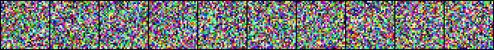
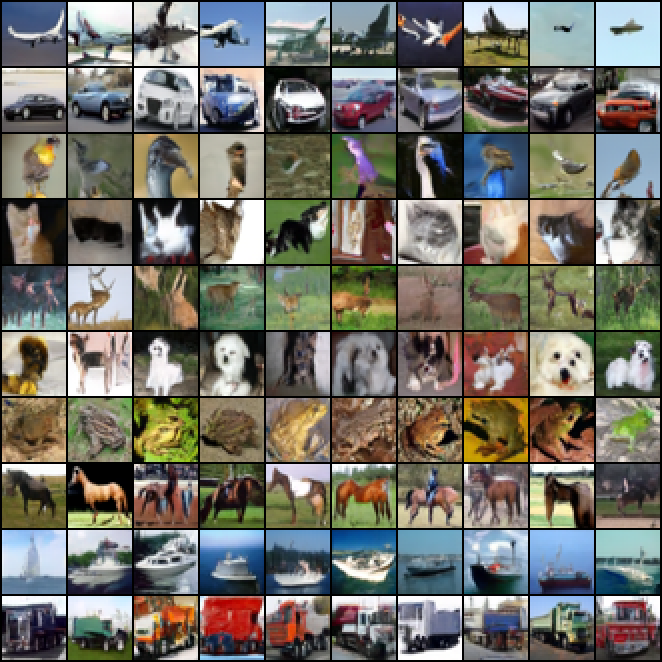
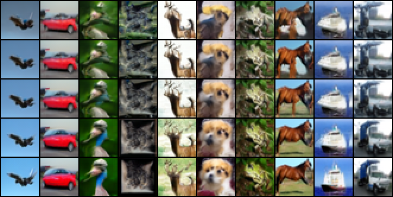
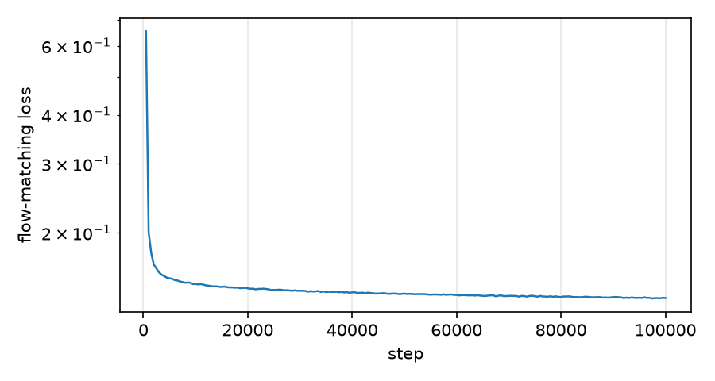
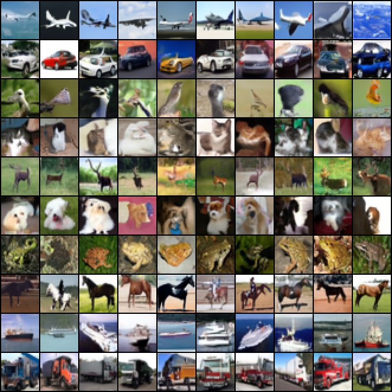

# dit-from-scratch

A class-conditional **Diffusion Transformer** (DiT, [Peebles & Xie 2023](https://arxiv.org/abs/2212.09748)) trained with **rectified flow matching**, written from tensor ops up in PyTorch. Same model family as Stable Diffusion 3 and Flux, sized for CIFAR-10 and trained in about 3 hours on one consumer GPU.



## Samples

DiT-S/2 (32.5M params), 100k steps, EMA weights, Heun sampler with 50 steps, classifier-free guidance 2.0. One row per class: airplane, automobile, bird, cat, deer, dog, frog, horse, ship, truck.



**Guidance sweep.** Same starting noise in every row; guidance scale 1.0, 1.5, 2.0, 3.0, 4.0 top to bottom. Higher guidance trades diversity for class fidelity and contrast.



## What's hand-written

| Piece | Where | Verified by |
|---|---|---|
| Patchify / unpatchify via `reshape` + `permute` | `model.py` | Exact round-trip; patch embedding proven equal to a strided `Conv2d` |
| Multi-head attention via `einsum` | `model.py` | Matches `F.scaled_dot_product_attention` to 1e-5, op-level and whole-model |
| adaLN-Zero conditioning (timestep + class modulate every block) | `model.py` | Model outputs exactly zero at init, every block starts as identity |
| Fused modulated LayerNorm with a **hand-derived backward** (`torch.autograd.Function`) | `ops.py` | `torch.autograd.gradcheck` in float64; matches plain PyTorch forward |
| Rectified flow: logit-normal timesteps, label dropout, Euler + Heun ODE samplers, CFG | `flow.py` | Overfit check: 16 images memorized (nearest-neighbour MSE 0.014 vs 0.235 for unrelated images) |
| GPU-resident data pipeline (no DataLoader), `foreach` EMA, bf16 autocast | `train.py` | Full run below |

The backward of `y = LN(x)·(1 + scale) + shift`, with `x̂ = (x − μ)·rstd` and `g = dy·(1 + scale)`:

```
d_shift = Σ_tokens dy
d_scale = Σ_tokens dy · x̂
dx      = rstd · (g − mean_D(g) − x̂ · mean_D(g · x̂))
```

## Training



| | |
|---|---|
| Model | DiT-S/2: 12 blocks, width 384, 6 heads, 2×2 patches → 256 tokens |
| Data | CIFAR-10 train (50k), random horizontal flips |
| Optimizer | AdamW, lr 1e-4, 1k-step warmup, no weight decay, grad clip 1.0 |
| Batch / steps | 128 / 100k (≈256 epochs) |
| Precision | bf16 autocast, `torch.compile`, SDPA attention, custom norm op |
| Hardware / time | RTX 4070 Ti SUPER 16 GB, 9.4 steps/s, ≈3 h |
| Final loss | 0.136 |

## Sample quality (FID)

FID against CIFAR-10 train statistics with [clean-fid](https://github.com/GaParmar/clean-fid) (Inception-v3, `clean` resizing), EMA weights, Heun 50 steps (99 model evaluations), uniformly random class labels. `python fid.py --ckpt ... --num 50000 --cfg 2.0`

| Guidance | FID-10k | FID-50k |
|---|---|---|
| 1.0 (none) | 18.76 | |
| 1.5 | 11.93 | |
| **2.0** | **10.97** | **8.97** |
| 3.0 | 16.06 | |

FID-10k runs a few points higher than FID-50k from sample-size bias, so the sweep only picks the scale. For scale: the original DDPM (35.7M params, unconditional) reports 3.17 after 800k steps at batch 128, 8× the steps of this 3-hour run.

## Benchmarks

RTX 4070 Ti SUPER, torch 2.6.0+cu124, Windows (`triton-windows` for `torch.compile`). Reproduce with `python bench.py`.

### Attention, forward + backward (B=8, heads=6, head_dim=64, bf16)

| tokens | einsum ms | SDPA ms | einsum MiB | SDPA MiB |
|---|---|---|---|---|
| 256 | 0.51 | 0.20 | 48 | 6 |
| 1024 | 6.74 | 1.16 | 768 | 24 |
| 4096 | 119.82 | 17.29 | 12288 | 98 |

The `einsum` path materializes the full N×N score matrix, so its memory grows quadratically: 12 GiB at 4096 tokens against 98 MiB for the fused kernel, which tiles the computation and never stores it.

### Modulated LayerNorm, forward + backward (128×256×384, bf16 inputs)

| implementation | ms | peak MiB |
|---|---|---|
| plain PyTorch (autograd) | 0.63 | 96 |
| custom autograd.Function | 3.01 | 312 |
| plain PyTorch, compiled | 0.32 | 48 |
| custom, compiled | 0.43 | 48 |

Eager, the custom op loses: it runs as ~10 separate kernels and upcasts bf16 inputs to fp32 for its statistics, where `F.layer_norm` is a single fused kernel. Compiled, Inductor fuses the hand-written forward and backward into the same footprint as the built-in.

### DiT-S/2 training step (batch 128, bf16 autocast)

| compiled | attention | norm | steps/s | peak GiB |
|---|---|---|---|---|
| no | einsum | custom | 3.87 | 9.8 |
| no | einsum | plain | 4.41 | 10.9 |
| no | SDPA | custom | 5.47 | 6.5 |
| no | SDPA | plain | 6.59 | 7.5 |
| yes | einsum | custom | 7.95 | 8.5 |
| yes | einsum | plain | 7.96 | 8.5 |
| yes | SDPA | custom | 9.37 | 6.3 |
| yes | SDPA | plain | 9.35 | 6.3 |

In the real model the residual stream is fp32 under autocast, and there the eager custom op uses **1 GiB less** than plain PyTorch: it saves only `x̂`, `rstd` and `scale` for backward, where autograd keeps every intermediate of the LayerNorm-then-modulate chain. Compiled, the two are identical in speed and memory, which is how the final model was trained: hand-written op, no speed penalty.

## Rust port (Candle)

`rust/` reimplements the trained model's forward pass and Heun sampler in [Candle](https://github.com/huggingface/candle), loading the same EMA weights from safetensors. Nothing is shared with the Python code: patchify (6-D permutes), the sin-cos position table (rebuilt in Rust, it's not in the checkpoint), timestep embedding, attention, adaLN-Zero, modulated LayerNorm and CFG are all re-derived. `export.py` writes the weights plus PyTorch reference outputs; `dit-rs parity` checks against them.

| Check (fp32) | max \|Rust − PyTorch\|, CPU | CUDA | tolerance |
|---|---|---|---|
| One forward pass, 4 images at t ∈ {0.1, 0.4, 0.7, 0.95} | 5.0e-6 | 3.1e-6 | 1e-4 |
| Full sample: 10 Heun steps, CFG 2.0, from fixed noise | 6.9e-6 | 3.2e-6 | 1e-3 |

Errors stay at float32 rounding level through 19 chained model evaluations.



*Generated entirely by the Rust binary: 20 Heun steps, CFG 2.0, its own seeded noise (so not pixel-identical to the PyTorch grid).*

Inference speed, fp32 eager on both sides (PyTorch with the `einsum` attention path and TF32 off, to match Candle), warm runs, idle RTX 4070 Ti SUPER:

| Workload | Rust CPU | PyTorch CPU (12 threads) | Rust CUDA | PyTorch CUDA |
|---|---|---|---|---|
| 2 images, 10 Heun steps, CFG 2.0 | 13.4 s | 1.8 s | **0.18 s** | 0.20 s |
| 100 images, 50 Heun steps, CFG 2.0 | — | — | 35.0 s | **22.5 s** |

- **CPU:** Candle's pure-Rust matmuls are ~7× slower than PyTorch's oneDNN/MKL. Building with `-C target-cpu=native` changed nothing (12.7 vs 12.8 s), so elementwise code isn't the bottleneck. Candle's `mkl` feature only links with the MSVC toolchain (it hard-requires Intel's `libiomp5md`).
- **CUDA:** 74× faster than Rust CPU. At small batch Candle edges out PyTorch (less per-op overhead); at batch 200 PyTorch's fused kernels win by 1.6×.
- **Footprint:** a 17 MB CPU binary, no Python runtime, against a 4.4 GB `torch` install.

```bash
python export.py --ckpt runs/s2/ckpt.pt --out rust      # model.safetensors + fixtures.safetensors
cd rust
cargo build --release
./target/release/dit-rs parity model.safetensors fixtures.safetensors
./target/release/dit-rs sample model.safetensors grid.png 2.0 20 0   # cfg, steps, seed

# GPU: needs the CUDA toolkit (nvcc); set CUDA_COMPUTE_CAP, e.g. 89 for Ada
cargo build --release --features cuda
```

Windows notes: with the `x86_64-pc-windows-gnu` toolchain, `getrandom` needs `dlltool.exe` on `PATH` (e.g. from WinLibs MinGW-w64). The `cuda` feature needs the MSVC toolchain (`cargo +stable-x86_64-pc-windows-msvc`) run from a Visual Studio developer shell, since `nvcc` uses `cl.exe` as its host compiler. `rust/build_cuda.bat` does all of that: it finds MSVC and CUDA, reads the compute capability from `nvidia-smi`, and builds `rust/target-cuda/release/dit-rs.exe`.

## Usage

**Pretrained weights** (DiT-S/2, EMA, step 100k, fp32) are on the [v1.0.0 release](https://github.com/j-rmccrery/dit-from-scratch/releases/tag/v1.0.0): `dit_s2_cifar10_ema.safetensors` (130 MB) and the Rust parity `fixtures.safetensors`.

```bash
gh release download v1.0.0 -R j-rmccrery/dit-from-scratch      # or download from the release page
python sample.py --ckpt dit_s2_cifar10_ema.safetensors --out assets
./rust/target/release/dit-rs parity dit_s2_cifar10_ema.safetensors fixtures.safetensors
```

From scratch:

```bash
pip install -r requirements.txt          # + triton-windows on Windows for --compile
python test_core.py                      # correctness checks, CPU, seconds

# sanity check: memorize 16 images (~1 min)
python train.py --overfit 16 --model xs --steps 2000 --lr 3e-4 --sample-every 500 --out runs/overfit

# full run (~3 h on a 4070 Ti SUPER)
python train.py --model s --steps 100000 --sdpa --compile --out runs/s2

python sample.py --ckpt runs/s2/ckpt.pt --out assets
python bench.py
python fid.py --ckpt runs/s2/ckpt.pt --num 50000 --cfg 2.0   # ~40 min
```

## Layout

| File | Contents |
|---|---|
| `model.py` | DiT: patch embedding, 2D sin-cos positions, attention, adaLN-Zero blocks, CFG forward |
| `ops.py` | Custom autograd op + plain-PyTorch reference |
| `flow.py` | Rectified-flow loss and samplers |
| `train.py` | Training loop, overfit mode, checkpoint/resume |
| `sample.py` | Sample grid, guidance sweep, denoising GIF, loss plot |
| `bench.py` | The benchmark tables above |
| `fid.py` | FID via clean-fid, with a guidance sweep |
| `export.py` | Weights + parity fixtures for the Rust port |
| `rust/` | Candle inference port: `model.rs` (DiT + sampler), `main.rs` (`parity`, `sample` CLI) |
| `test_core.py` | Correctness checks |

## Roadmap

- [x] Model, custom op, tests
- [x] Overfit sanity check
- [x] Full CIFAR-10 training run
- [x] Samples, denoising GIF, benchmarks
- [x] Rust inference port (Candle) with numerical parity against PyTorch
- [x] Pretrained weights release, FID-50k, Candle CUDA backend
